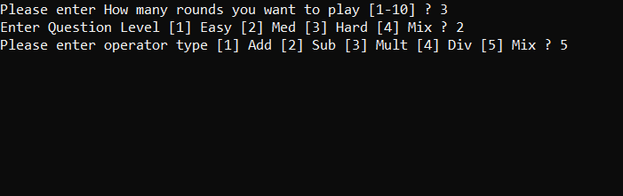
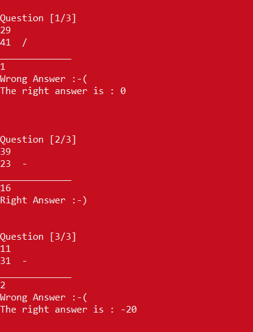
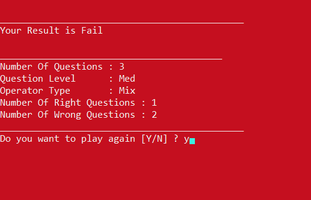

Math Game

A game where you choose the difficulty level and the type of mathematical operation, then solve a series of math problems.

📌 Overview

This project was developed to practice fundamental C++ concepts such as enums, loops, functions and procedures, input and output streams, variables, and functional programming, focusing on the Divide and Conquer strategy.

It focuses on building a clean, organized, and maintainable application.

✨ Features

- When starting a game, the system asks you to choose the number of rounds and the question difficulty, which has three levels: Easy, Normal, and Hard.
- You then choose the type of mathematical operation you will face. You can choose between addition, subtraction, division, and multiplication, or select Mixed to include all the operations mentioned above.
- When you answer correctly, the screen turns green and displays a success message. If you answer incorrectly, the screen turns red and displays an error message along with the correct answer.
- After all rounds are completed, the system calculates the number of correct and incorrect answers and determines your final result.
- The system handles division by zero smoothly.
- The system asks the user whether they want to play again and restarts the game if they do.
- The project practices the Divide and Conquer strategy, in which each simple task is implemented in a separate method.

🛠️ Technologies Used

- Language: C++
- IDE: Visual Studio

📸 Screenshots

## Game Settings

## Rounds UI

## Final Results

🚀 Getting Started

Prerequisites

- Visual Studio
- Git (optional)

Installation

1. Clone the repository:
   
   git clone YOUR_REPOSITORY_URL
   
   Alternatively, download the project files directly.

2. Open the solution file (".sln") in Visual Studio.

3. Build and run the project.

🧠 Concepts Practiced

- Functional programming
- Fundamental C++ concepts and data structures
- Divide and Conquer strategy
- Input validation
- Handling mathematical calculations and edge cases

📂 Project Structure

Math Game/
├── Screenshots/
│   ├── p1.png
│   └── p2.png
├── .gitattributes
├── .gitignore
├── ConsoleApplicationForGitHub.sln
├── ConsoleApplicationForGitHub.csproj
├── Program.cs
├── LICENSE.txt
└── README.md

👨‍💻 Author

Osama Arafat

- GitHub: "@ososdays" (https://github.com/ososdays)

📄 License

This project is licensed under the MIT License.
